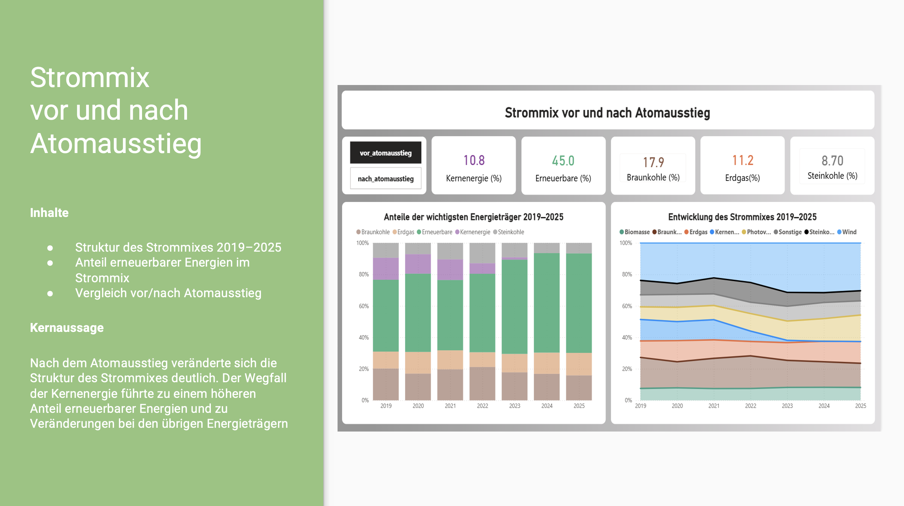

# Atomausstieg 2023 – Analyse des deutschen Strommarktes

Dieses Abschlussprojekt untersucht die Entwicklung von Strommix,
Stromhandel und Haushaltsstrompreisen in Deutschland im Zeitraum
2019–2025. Ziel ist es, Veränderungen vor und nach dem Atomausstieg
2023 anhand von Daten zu beschreiben und in Power BI zu visualisieren.

## Fragestellungen

- Wie hat sich der deutsche Strommix verändert?
- Wie entwickelten sich erneuerbare Energien, Stromimporte und
  Stromverbrauch im Vergleich zur weggefallenen Kernenergie?
- Wie entwickelten sich Haushaltsstrompreise und ihre Bestandteile?
- Welche Entwicklungen zeigen Stromhandel und Brennstoffpreisindizes?

## Datenquellen

- **[SMARD – Bundesnetzagentur](https://www.smard.de/):**
  Stromerzeugung nach Energieträgern und kommerzieller Stromaußenhandel.
- **[Statistisches Bundesamt (Destatis)](https://www.destatis.de/):**
  Strompreise und Preisbestandteile aus
  [GENESIS-Online](https://www-genesis.destatis.de/)
  sowie Veröffentlichungen zur Energiepreisentwicklung.

## Technologien und Vorgehen

1. **Python und pandas:** Bereinigung der Rohdaten in Jupyter Notebooks
   und Export als CSV.
2. **PostgreSQL:** Erstellung von Tabellen mit passenden Datentypen,
   Import der bereinigten Daten und Entwicklung analytischer Views
   mit Aggregationen, Joins, CTEs und Fensterfunktionen.
3. **Power BI und DAX:** Aufbau des Datenmodells, Erstellung von
   Kennzahlen und Visualisierung auf vier Berichtsseiten.

## Zentrale Erkenntnisse

Im Vergleich der untersuchten Zeiträume vor und nach dem Atomausstieg:

- stieg der Anteil erneuerbarer Energien am Strommix;
- lagen die durchschnittlichen Stromimporte höher;
- lag der durchschnittliche berechnete Stromverbrauch niedriger.

Die Analyse beschreibt zeitliche Veränderungen und weist keinen
isolierten kausalen Effekt des Atomausstiegs nach. Weitere Ergebnisse,
insbesondere zu Strompreisen, sind in der Präsentation dokumentiert.

## Dashboard-Vorschau

[Weitere Dashboard-Screenshots und Datenmodell ansehen](04_powerbi/)

## Inhalt des Repositories

| Ordner | Inhalt |
|---|---|
| [01_raw_data](01_raw_data/) | Rohdaten |
| [02_python_preprocessing](02_python_preprocessing/) | Jupyter Notebooks und bereinigte Daten |
| [03_sql](03_sql/) | Tabellenerstellung, analytische Views und SQL-Ergebnisse |
| [04_powerbi](04_powerbi/) | Power-BI-Datei, Dashboard-Screenshots und Datenmodell-Abbildung |
| [05_presentation](05_presentation/) | Abschlusspräsentation |
| [06_documentation](06_documentation/) | Begleitende Dokumentation zu Datenaufbereitung, SQL und Power BI |

## Projekt ansehen

Code, Notebooks und Screenshots können direkt auf GitHub betrachtet
werden, sofern die Vorschau verfügbar ist.

- **[Abschlusspräsentation](05_presentation/Atomausstieg_2023.pptx):**
  herunterladen und mit PowerPoint oder einer kompatiblen Anwendung öffnen.
- **[Power-BI-Bericht](04_powerbi/Abschlussprojekt.pbix):**
  herunterladen und mit Power BI Desktop interaktiv nutzen.
- **[Dokumentation](06_documentation/):**
  ergänzende Erläuterungen zur Umsetzung.
